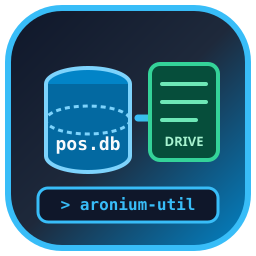
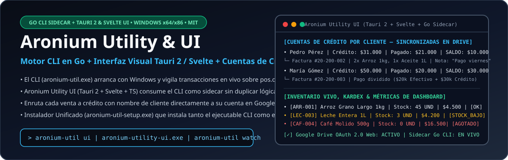
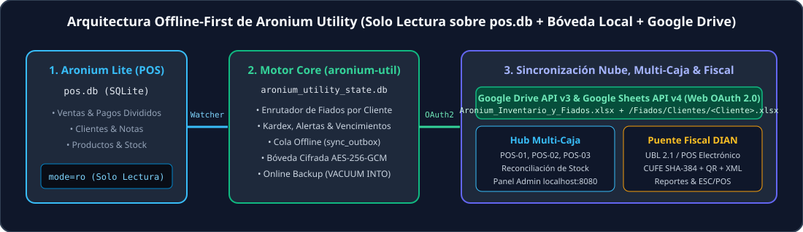

<div align="center">



# Aronium Utility & Aronium Utility UI

**Open-Source Windows POS Companion for Aronium Lite (`pos.db`) — Go CLI Engine (`aronium-util.exe`) + Tauri 2, Svelte & TypeScript Desktop UI (`aronium-utility-ui.exe`) + Customer Credit Accounts, Live Inventory Table & Direct Web OAuth 2.0 Google Drive / Sheets Sync**

[](https://github.com/SilverFeit/Aronium-Utility/releases/latest)
[-0078D6?style=flat-square&logo=windows)](https://github.com/SilverFeit/Aronium-Utility/releases/latest)
[](#architecture-tauri-2--svelte--typescript--go-cli-sidecar)
[-10b981?style=flat-square)](#architecture-tauri-2--svelte--typescript--go-cli-sidecar)
[-22c55e?style=flat-square)](#direct-google-drive--sheets-web-authentication)
[](LICENSE)

```powershell
# Unified 1-Click Windows Setup Installer (installs aronium-util.exe + aronium-utility-ui.exe, sets PATH & registers boot startup)
.\aronium-util-setup-x64.exe --register POS-01 --store-id STORE-01 --launch-ui
```

[**Download Unified Windows Installer (`.exe`)**](https://github.com/SilverFeit/Aronium-Utility/releases/latest) · [**Aronium Utility UI (Tauri 2 + Svelte)**](#architecture-tauri-2--svelte--typescript--go-cli-sidecar) · [**Google Drive Web Auth**](#2-direct-google-drive--sheets-web-authentication) · [**Customer Credit & Inventory Table**](#1-customer-credit-accounts--live-inventory-table-in-google-drive) · [**CLI Reference**](#command-line-interface-aronium-util) · [**User Guide**](docs/USER_GUIDE.md) · [**Technical Spec**](docs/SPEC.md) · [**Español**](#-español--resumen-del-proyecto)

<br />



</div>

---

## Overview

**Aronium Utility** combines a high-performance **100% Go CLI & Background Sync Engine (`aronium-util.exe`)** with a lightweight **Tauri 2 + Svelte 5 + TypeScript Desktop Application (`Aronium Utility UI` / `aronium-utility-ui.exe`)** designed for retail stores running **Aronium Lite** (`%LOCALAPPDATA%\Aronium\Data\pos.db`).

- **Automatic Background Execution on PC Startup:** As soon as the POS computer powers on, `aronium-util.exe watch` runs automatically in the background, reading `pos.db` in strict read-only mode (`mode=ro&_busy_timeout=5000`) and processing live sales, inventory updates, and customer credit accounts in real time.
- **Visual Desktop Interface (`Aronium Utility UI`) with Zero Duplicated Logic:** Whenever a store clerk or manager wants to visually inspect the dashboard, check sales metrics, validate inventory/Kardex, or add an annotation/credit account for a customer, they can open **Aronium Utility UI** (either by clicking **`aronium-utility-ui.exe`** or running **`aronium-util ui`**). Built with **Tauri 2 + Svelte + TypeScript**, the UI draws via the operating system's native WebView (zero Chromium/Electron bloat) and consumes the existing Go CLI as a **sidecar process** over IPC/JSON — **never duplicating a single line of business logic**.

> **Legal & Compliance Disclaimer:** *Aronium Utility* is an independent open-source interoperability, backup, analytics, and cloud synchronization suite licensed under the MIT License. It reads the local SQLite database (`pos.db`) generated by Aronium Lite in strict read-only mode. It does not modify proprietary binaries, evade licensing systems, or replace official Aronium Pro support.

<details open>
<summary><strong>🇪🇸 Español — Resumen del Proyecto y Arquitectura</strong></summary>

<br />

**Aronium Utility** une el motor de ejecución en **Go (`aronium-util.exe`)** con la aplicación gráfica de escritorio **Aronium Utility UI (`aronium-utility-ui.exe`)** construida con **Tauri 2 + Svelte + TypeScript**:

1. **Instalador Unificado para Windows (`aronium-util-setup-x64.exe` / `aronium-util-setup-x86.exe`):**
   - Una sola instalación crea tanto el ejecutable del CLI (**`aronium-util.exe`**) como el ejecutable de la interfaz gráfica (**`aronium-utility-ui.exe`**), configura el `PATH` y las variables de entorno de Windows, crea el acceso directo en el Escritorio y registra el arranque automático con el sistema.
2. **Operación en Vivo desde que se Enciende el Equipo + Interfaz Visual para el Dependiente:**
   - Apenas se enciende el computador de caja, el CLI (`aronium-util.exe watch`) se ejecuta automáticamente en segundo plano vigilando las transacciones en vivo sobre `pos.db`.
   - Cuando el dependiente o administrador desea ver de forma visual el **Dashboard y Métricas**, validar el **Inventario y Kardex**, o **agregar una anotación / compromiso de pago / límite de crédito** a la cuenta de un cliente, abre **Aronium Utility UI** (desde el ejecutable `aronium-utility-ui.exe` o ejecutando `aronium-util ui`).
   - **Cero Duplicación de Lógica:** Siguiendo la arquitectura **Tauri 2 + Svelte + TypeScript → Sidecar CLI**, la interfaz gráfica actúa exclusivamente como capa de presentación e interacción consumiendo los resultados JSON del CLI en Go.
3. **Conexión Directa a Google Drive vía Web + Tabla Unificada de Inventario y Cuentas de Crédito por Cliente:**
   - Al pasar una factura en Aronium Lite con el nombre de un cliente y pago a crédito (o pago dividido), el motor enruta automáticamente la factura, los productos comprados y las anotaciones a la cuenta individual de ese cliente en **`Aronium_Inventario_y_Cuentas_Credito.xlsx`** y **`/AroniumUtility/Cuentas_Credito/Clientes/<Nombre_Cliente>.xlsx`** en Google Drive y Google Sheets.

</details>

---

## Architecture: Tauri 2 + Svelte + TypeScript → Go CLI Sidecar

<div align="center">
 Go CLI Sidecar (aronium-util) -> pos.db & Google Drive" width="100%" />
</div>

```text
Desktop UI — Svelte 5 + TypeScript (Aronium Utility UI)
Components, credit account forms, live inventory tables, navigation & dashboard metrics
      │
      ▼  Tauri 2 IPC / Commands
Tauri Core — Rust & Native Sidecar Host (`aronium-utility-ui.exe`)
Process management, file permissions & sidecar IPC communication (OS WebView — 0% Chromium bundle)
      │
      ▼  Sidecar Execution (`aronium-util.exe <command> --json`)
Existing Go CLI (`aronium-util.exe`)
100% of business logic preserved + automatic background watcher on Windows startup
      │
      ▼  Data & Outputs
JSON · SQLite (`pos.db` mode=ro + `aronium_utility_state.db`) · `.xlsx` · Google Drive v3 & Sheets v4
```

---

## Key Features

### 1. Customer Credit Accounts & Live Inventory Table in Google Drive
- **Automatic Customer Account Routing:** Whenever a sale is recorded in Aronium Lite with unpaid status (`PaidStatus = 0`), a credit payment type (`"Crédito"`, `"Credit"`, `"Cuenta Corriente"`, `"Cuenta Cliente"`, `"Cartera"`), or a **split payment** under a customer's name, `aronium-util` routes the invoice, itemized products, and notes directly to that customer's credit account.
- **Partial Payments & Credit Limits:** Automatically detects partial payments, recalculates historical credit vs. active pending balance, enforces per-customer credit limits (`LIMITE_EXCEDIDO`), and tracks overdue days (`VENCIDO`).
- **Unified Multi-Sheet Workbook (`Aronium_Inventario_y_Cuentas_Credito.xlsx`):**
  - `Resumen_Cuentas_Credito`: Consolidated customer ledger (Total Historical Credit, Total Paid, **Pending Balance**, Credit Limit, Available Credit, Overdue Days, Status, and Notes).
  - `Detalle_Cuentas_Credito`: Invoice-by-invoice breakdown with itemized products, payment split, and combined notes.
  - `Inventario`: Live catalog with SKU, Barcode, Category, Current Stock, Min Stock, Unit Cost, Sale Price, Total Valuation, Margin %, and Stock Status (`OK`, `STOCK_BAJO`, `AGOTADO`, `STOCK_NEGATIVO`).
  - `Cliente_<Nombre>` tabs + `/AroniumUtility/Cuentas_Credito/Clientes/<Nombre_Cliente>.xlsx` and ready-to-share text statements.

### 2. Direct Google Drive & Sheets Web Authentication
- Click **"Autenticar Google Drive vía Web (OAuth 2.0)"** inside **Aronium Utility UI** or run `aronium-util drive login`.
- Launches an embedded loopback OAuth 2.0 portal (`http://127.0.0.1:8765`), opens the system browser to authenticate with Google, encrypts your OAuth token with **AES-256-GCM** (`gdrive.token.enc`), and updates your files in Google Drive API v3 using **stable `file_id`s** plus live cell batch updates via **Google Sheets API v4**.

### 3. Aronium Utility UI (`aronium-utility-ui.exe` / `aronium-util ui`)
- **6 Visual Workspaces Powered by the Go CLI Sidecar:**
  1. **Dashboard & Live Metrics:** Consolidated sales KPIs, active customer credit portfolio, inventory valuation, stock alerts, sales by cash register bar visualization, and top-selling products.
  2. **Customer Credit Accounts Manager:** Clerk form to add annotations/payment commitments and credit limits with instant Google Drive sync, plus expandable customer transaction histories and statements.
  3. **Live Inventory, Alerts & Kardex:** Searchable stock table with status filters and real-time Kardex movement viewer.
  4. **Cash Register Comparison (`POS-01`, `POS-02`):** Per-register transaction counts, cash vs. credit sales, and average ticket metrics.
  5. **Google Drive & Hot Backups:** 1-click Google Drive web login, instant table sync, and encrypted (`AES-256-GCM`) hot SQLite backup generator (`VACUUM INTO`).
  6. **System Health Doctor & Auto-Start Service Control:** Live `PRAGMA quick_check` diagnostics and Windows boot startup registration.

---

## Unified Installation on Windows (Installs CLI + UI + Boot Auto-Start)

### Option A — 1-Click Unified Windows Installer (`.exe` — Recommended)

1. Go to [**GitHub Releases (`latest`)**](https://github.com/SilverFeit/Aronium-Utility/releases/latest).
2. Download **`aronium-util-setup-x64.exe`** *(or `aronium-util-setup-x86.exe` for 32-bit Windows POS terminals)*.
3. Run the installer:
   ```powershell
   .\aronium-util-setup-x64.exe
   ```
   Or customize the cash register ID, store ID, and launch **Aronium Utility UI** immediately:
   ```powershell
   .\aronium-util-setup-x64.exe --register POS-01 --store-id STORE-01 --launch-ui
   ```

The unified installer automatically:
- Installs **`aronium-util.exe`** (Go CLI Engine) and **`aronium-utility-ui.exe`** (Aronium Utility UI) into `%LOCALAPPDATA%\Programs\AroniumUtility\`.
- Adds `%LOCALAPPDATA%\Programs\AroniumUtility` to your Windows User **`PATH`** and configures `ARONIUM_*` environment variables in `HKCU\Environment`.
- Registers **`aronium-util.exe watch`** in Windows Startup (`HKCU\Software\Microsoft\Windows\CurrentVersion\Run` & Scheduled Tasks) so the CLI starts automatically as soon as the computer turns on.
- Creates a Desktop shortcut for **Aronium Utility UI**.

### Option B — Portable `.zip` with `install.bat` / `install.ps1`

1. Download **`Aronium-Utility-1.1.0-windows-x64.zip`** *(or `Aronium-Utility-1.1.0-windows-x86.zip`)*.
2. Extract the archive and double-click **`install.bat`** *(or run `.\install.ps1` in PowerShell)*.

---

## Launching Aronium Utility UI & CLI Commands

```powershell
# Launch Aronium Utility UI (Tauri 2 + Svelte + TypeScript Desktop Interface)
aronium-utility-ui
# Or launch the UI directly from the CLI:
aronium-util ui

# Connect Google Drive & Google Sheets directly via Web Browser (OAuth 2.0)
aronium-util drive login
aronium-util drive status

# Synchronize Inventory + Customer Credit Accounts to Google Drive & Sheets
aronium-util sync

# Manage Customer Credit Accounts, add notes, set credit limits & generate statements
aronium-util credit list
aronium-util credit list --customer "Pedro"
aronium-util credit note add "Pedro Pérez" "Compromiso de pago el viernes" --promise 2026-11-25
aronium-util credit limit 2 50000
aronium-util credit statement "Pedro Pérez"

# Query Live Inventory, Stock/Expiration Alerts, Kardex & Price Lists
aronium-util inventory list
aronium-util inventory alerts --expire-days 15
aronium-util inventory kardex
aronium-util inventory pricelists --list-name Mayorista

# Health Diagnostics, Background Watcher & Windows Auto-Start Service
aronium-util doctor
aronium-util watch
aronium-util service install
aronium-util service status

# Hot Encrypted SQLite Backups (VACUUM INTO + AES-256-GCM + SHA-256 + Verified Restore)
aronium-util backup create --passphrase "MySecureKey2026"
aronium-util backup verify --file "%LOCALAPPDATA%\AroniumUtility\backups\aronium_backup_....db.zip.enc" --passphrase "MySecureKey2026"
```

---

## Project Structure

```text
Aronium-Utility/
├── go.mod                               # Pure-Go module (modernc.org/sqlite + gopkg.in/yaml.v3 — zero CGO)
├── VERSION                              # Single source of truth for release version (1.1.0)
├── cmd/
│   ├── aronium-util/                    # Main Go CLI & background startup watcher (`aronium-util.exe`)
│   ├── aronium-utility-ui/              # Desktop UI executable (`aronium-utility-ui.exe`) consuming Go CLI sidecar
│   └── aronium-util-setup/              # Unified Windows Setup Installer (`aronium-util-setup-x64.exe` / `x86.exe`)
├── ui/                                  # Tauri 2 + Svelte 5 + TypeScript Desktop UI source
│   ├── package.json                     # Svelte 5 + TypeScript + Vite + @tauri-apps/api
│   ├── src/
│   │   ├── App.svelte                   # 6-tab visual interface (Dashboard, Credit Accounts, Inventory, Registers, Drive, Doctor)
│   │   ├── lib/ipc.ts                   # Tauri 2 IPC + Sidecar JSON adapter (0% duplicated business logic)
│   │   └── lib/types.ts                 # TypeScript contracts matching aronium-util --json outputs
│   └── src-tauri/                       # Tauri 2 Rust Core (`Cargo.toml`, `tauri.conf.json`, `src/lib.rs`)
├── internal/
│   ├── config/                          # Declarative YAML config, AES-256-GCM secret vault & PII masking
│   ├── db/                              # Strict read-only pos.db adapter, state DB migrations, ATTACH & doctor
│   ├── events/                          # File-system + polling watcher, typed Event Bus & Webhook/Script hooks
│   ├── service/                         # Windows startup registry & background service manager
│   ├── credit/                          # Customer credit detection, split payments, partial payments, routing & statements
│   ├── inventory/                       # Live stock valuation, alerts, expirations, Kardex & price lists
│   ├── sync/                            # Direct Web OAuth 2.0 login, OpenXML .xlsx builder, Drive v3 & Sheets v4
│   ├── registers/                       # Cash register identity (POS-01, POS-02), conflict check & sales filter
│   ├── hub/                             # Multi-station Central Hub, offline queue & TC-021/TC-022 conflict engine
│   ├── admin/                           # Administrative Console snapshot engine (`--json`, TUI & localhost:8080)
│   ├── backup/                          # Hot SQLite online backup (VACUUM INTO), AES-256-GCM & verified restore
│   ├── migrate/                         # Multi-engine exporter (SQL Server, PostgreSQL, CSV, JSON) & MIG-004..006
│   ├── reports/                         # Daily closing reports, Dual Currency & ESC/POS printer router
│   ├── fiscal/                          # Modular FiscalProvider & UBL 2.1 electronic invoicing connector
│   └── testutil/                        # Synthetic realistic pos.db generator for tests & demos
├── installer/                           # Companion 1-click install.bat, install.ps1 & uninstall.bat scripts
├── Scripts/                             # Svelte + Go cross-platform Windows x64/x86 builder & release packager
├── docs/                                # User Guide, Technical Specification (`SPEC.md`) & SVG diagrams
└── tests/                               # Automated BDD (Gherkin) & QA Matrix (TC-001..TC-030) integration suite
```

---

## License

Released under the [MIT License](LICENSE). Copyright © 2026 [SilverFeit](https://github.com/SilverFeit).

---

<div align="center">

**Topics & Hashtags**

`#Windows` `#Aronium` `#AroniumLite` `#POS` `#PointOfSale` `#Tauri` `#Tauri2` `#Svelte` `#TypeScript` `#Golang` `#SQLite` `#GoogleDrive` `#GoogleSheets` `#OAuth2` `#InventoryManagement` `#CreditAccounts` `#UBL21` `#OfflineFirst` `#CLI` `#OpenSource`

</div>
